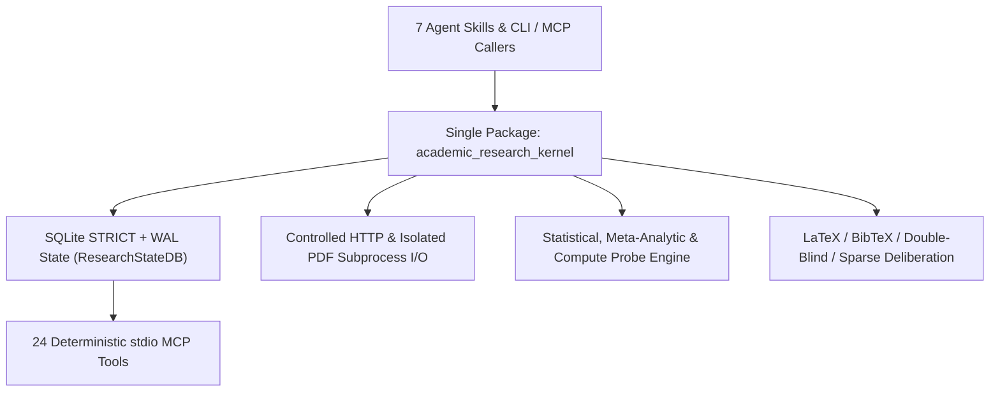

# Research-State Kernel Architecture (`v3.0.0`)

## Overview

`academic-research-kernel` (`v3.0.0`) is an offline-first, deterministic scholarly verification and manuscript engineering runtime built on Python's standard library, `SQLite` (`STRICT` tables + `WAL` journaling + `application_id = 0x41524B33`, `user_version = 3`), and on-demand scientific libraries (`numpy`, `scipy`, `statsmodels`, `jsonschema`).

Rather than scattering dozens of duplicated helper scripts across skill directories, `v3.0.0` consolidates the entire runtime inside a single installable package (`src/academic_research_kernel/`), exposing **24 stdio MCP tools**, **26 Draft 2020-12 JSON Schemas**, **20 CLI command groups** (with clean human-readable `3.0.0` verb-object aliases), and **7 First-Principles Agent Skills**:

---

## Core Architectural Pillars

### 1. Transactional SQLite Research State (`state_db.py`, `_stdlib.py`)

`ResearchStateDB` replaces ad-hoc multi-file JSON snapshot caches with relational `STRICT` tables protected by foreign keys, `SAVEPOINT` atomic batches, cycle-checked provenance graphs, and SHA-256 canonical JSON digests:
- **Database identity guard**: Rejects unrelated SQLite files (`application_id != 0x41524B33`) and refuses to open or downgrade databases created by newer schema versions (`user_version > 3`).
- **Research objects & provenance lineage**: Stores canonical object identities, content hashes, and directed derivation edges; inline graphs without verified content digests report `verification_status="unchecked"`, reserving `"intact"` strictly for hash-verified provenance chains.
- **Claim-Evidence Graph (`CEG`)**: Validates endpoint existence (`validate_ceg_semantics`), detects dangling support or relation edges, and derives deterministic evidence-anchor IDs over `canonical_json([artifact_id, locator])` so identically named tables across distinct runs never collide.
- **Decision ledger & retraction watch state**: Maintains append-only decision events and dual-sequence DOI watch state (`applied_seq` + `confirmed_seq`), preserving provider-scoped retraction signals (`openalex:` / `crossref:`) when a peer upstream source times out (`signals_complete=False`) and emitting `unacked_delta` alerts even when confirmed retractions arrive out of sequence after transient timeouts.

### 2. Controlled Network & Subprocess I/O (`research/sources.py`, `double_blind_sanitizer.py`)

- **DNS-pinned public HTTP (`controlled_urlopen`)**: Disables ambient proxies (`ProxyHandler({})`), resolves and pins public IPs before socket connection to block DNS-rebinding TOCTOU attacks, revalidates redirects, and enforces strict response byte caps.
- **Isolated PDF worker subprocess (`controlled_read_pdf_pages`)**: Extracts PDF page text, `/Info` metadata dictionaries, and raw XMP XML streams inside a `python -I -c` child process with wall-clock timeouts and bounded output drains (`pypdf==7.0.0`, `fonttools==4.65.0`). `research prepare`, `lint-submission`, and `sanitize-submission` route untrusted PDFs exclusively through this isolated worker.

### 3. Deterministic Statistical, Meta-Analytic & Forensic Engines (`recompute.py`, `meta_core.py`, `openreview_audit.py`)

- **Single-paper statistical audit (`recompute.py`, `table-forensics`)**: Exact `Decimal` rounding-interval verification for $t$, $F$, $\chi^2$, and Wald $z$ $p$-values, confidence-interval symmetry, `2x2` odds/risk ratios, `Cohen's d` / `Hedges' g`, percentage denominators, bounded-scale SD bounds, partition conservation, ablation constant-offset shifts, and hardware storage/bandwidth lower bounds.
- **Meta-analysis (`meta_core.py`, `meta-analyze`)**: Fixed-effect and DerSimonian-Laird random-effects pooling, $Q / I^2 / \tau^2$ heterogeneity, leave-one-out sensitivity, Egger regression, and trim-and-fill, using `min(v_i) / v_i` scaled inverse-variance weights so ultra-small variances (`1e-320`) never overflow IEEE-754 `1/v` to `NaN`.
- **Cross-venue OpenReview forensics (`openreview_audit.py`)**: Parses ICLR (`rating`, `confidence`, `soundness`, `informativeness`), ICML (`recommendation`), NeurIPS (`clarity`, `quality`, `originality`, `wc_strengths_and_weaknesses`), and COLM schemas offline without hitting live `openreview.net` Cloudflare blocks, computing score quantiles, unanimous identical-score rates, confidence-stratified review word-count medians, and zero-discussion rates.

### 4. Pre-Submission LaTeX, BibTeX & CEG Gatekeeper (`pre_submission_linter.py`)

- Resolves root-relative and parent-relative `\input{...}` and braceless `\input file` trees while masking comments, `\verb`, and `verbatim` / `lstlisting` / `minted` / `comment` environments line-accurately.
- Scopes BibTeX key and duplicate checks strictly to `\bibliography{...}` and `\addbibresource[...]{...}` declarations (with transitive `crossref` / `xdata` closure for `--check-academic-style` uncited-entry checks).
- Distinguishes conference template `[final]` / `[preprint]` / `[cameraready]` leaks from benign typesetting package options (`\usepackage[final]{microtype}`, `hyperref`, `listings`, `graphicx`).
- Counts shared body+`References` transition pages accurately toward main-body page limits when substantive prose precedes the bibliography heading.
- Verifies per-line `% ark:claim=<ID>` bindings against `eligible` CEG anchors and checks numeric/lexical consistency between manuscript sentences (including escaped `12.5\%`) and bound CEG claim statements.

---

## All 24 MCP Tools (`academic_research_kernel.mcp_server`)

1. `research_state_ingest` — Atomic batch ingestion of research objects, claims, decisions, and lineage edges into SQLite `STRICT` state.
2. `research_artifact_ingest` — Single-envelope ingestion returning tamper-evident mutation digests.
3. `research_artifact_validate` — Dry-run envelope and schema validation without mutating state.
4. `research_receipt_verify` — SHA-256 receipt verification against `ReceiptRef`.
5. `research_object_resolve` — Deterministic five-state entity resolution (`EXACT`, `STRONG_MATCH`, `CANDIDATE`, `CONFLICT`, `UNRESOLVED`).
6. `research_lineage_trace` — Provenance ancestry traversal across SQLite or inline graphs (`unchecked` vs hash-verified `intact`).
7. `claim_evidence_add` — Transactional insertion of claims and evidence bindings.
8. `claim_evidence_validate` — Schema + `validate_ceg_semantics` endpoint closure check (`ceg` or `graph` input).
9. `claim_evidence_trace` — Upstream evidence and receipt trace for a target claim.
10. `decision_record` — Append-only research decision & negative-result logging.
11. `decision_transition` — State-event transitions (`active`, `pruned`, `reopened`, `superseded`).
12. `decision_ledger_validate` — Structural & causal-ancestry validation of decision ledgers.
13. `decision_trace` — Causal fork and correction trace for a decision ID.
14. `academic_recompute_statistics` — 15 deterministic statistical and physical-bound checks.
15. `academic_check_percentage` — Integer numerator / denominator compatibility verification.
16. `academic_table_forensics` — Partition conservation, ablation offset, and uncompressed bandwidth bound checks.
17. `academic_meta_analyze` — Fixed/DL random-effects pooling, $Q/I^2/\tau^2$, subgroup $Q_{\text{between}}$, WLS meta-regression, LOO, Egger test, and trim-and-fill.
18. `academic_verify_source` — Identifier normalization and Crossref/OpenAlex bibliographic & update verification.
19. `academic_openreview_audit` — Offline mirror & forum score/forensics audit across ICLR, ICML, NeurIPS, and COLM.
20. `academic_double_blind_sanitize` — Redacted (`matched="[REDACTED]"`) double-blind leak scan across TeX, BibTeX, and PDF `/Info` + XMP streams.
21. `academic_pre_submission_lint` — Venue formatting, page-limit, BibTeX scope, CEG claim-binding, and academic-style gate.
22. `academic_retraction_watch` — Dual-source DOI retraction delta check backed by SQLite state.
23. `academic_scfabric_hardware_probe` (alias `academic_compute_probe`) — Degradation-tolerant CPU/GPU/library probe and optional `compute-receipt-1.0` benchmark.
24. `academic_cross_review` (alias `cross_review_deliberate`) — Multi-model sparse deliberation clustering, $O(N^3)$ derangement, anonymous challenge planning, and minority-protected synthesis.
